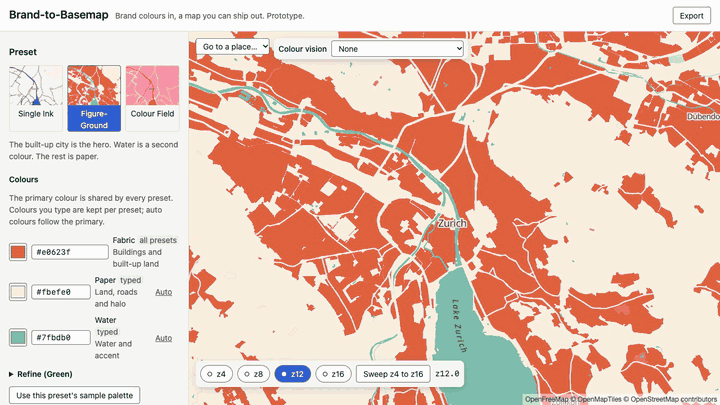
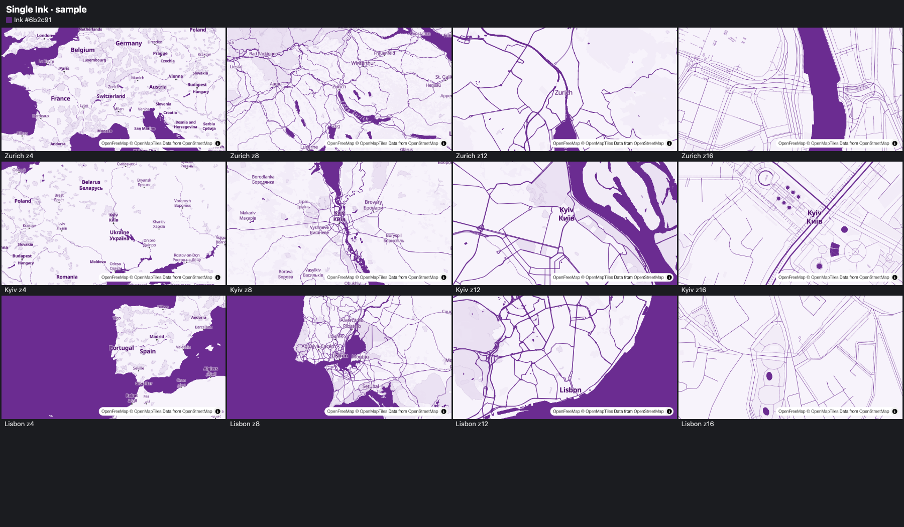
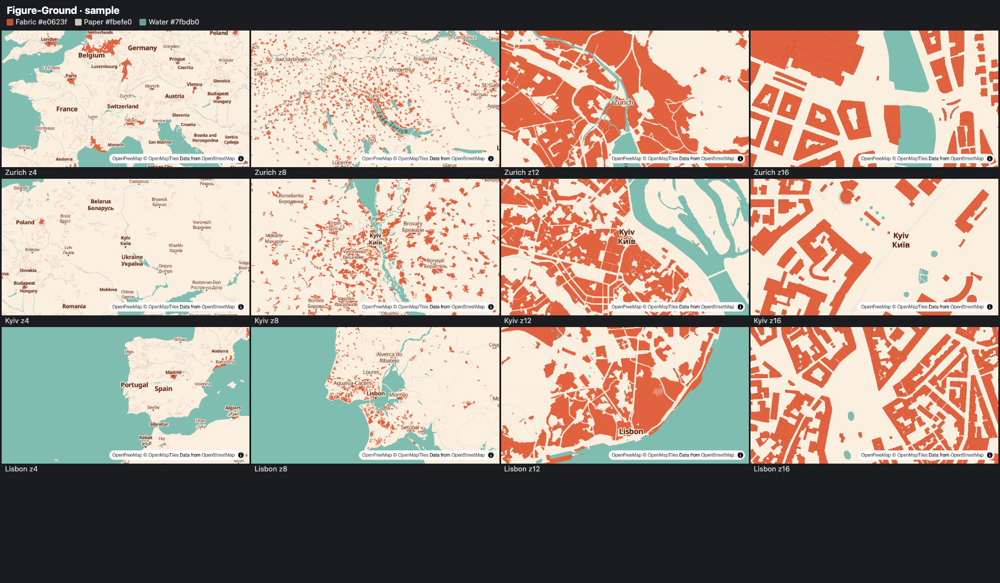
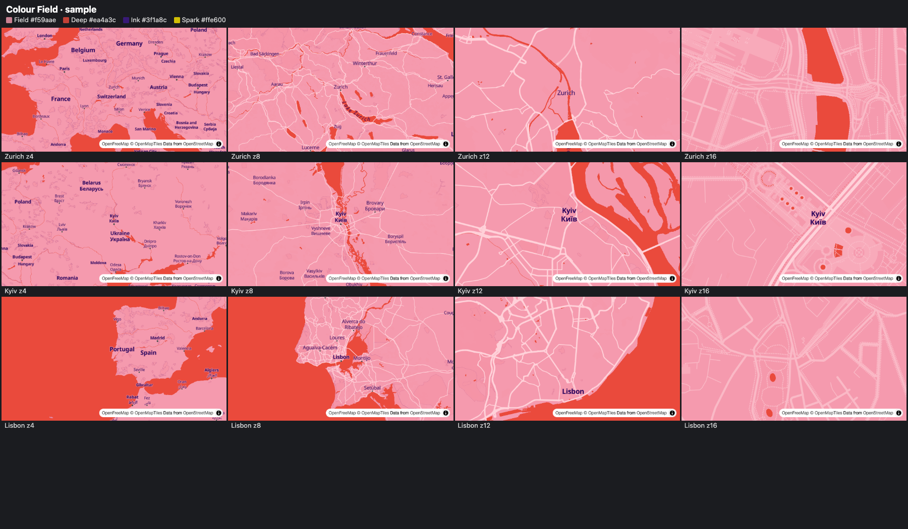
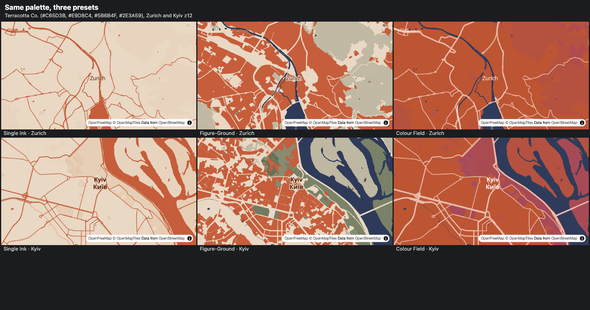

# Brand-to-Basemap

Brand-to-Basemap turns a brand colour into a map you can ship. Pick one of three presets, enter your primary colour, and the tool derives every colour on the map, checks that labels, roads and water stay readable, repairs what fails, and hands you an embed snippet, a MapLibre style and design tokens. It runs entirely in the browser on an open stack (MapLibre GL JS with OpenMapTiles-schema tiles), with no account and no key. It is a P0 prototype and part of a design case study: the interface is a working proof of concept, not a finished product.

**Try it: [artmarchuk.github.io/brand-to-basemap-poc](https://artmarchuk.github.io/brand-to-basemap-poc/)**



The same recording as video: [demo.mp4](docs/screens/demo/demo.mp4).

## How to use it

1. **Pick a preset and enter your primary colour.** That is the only decision you have to make. Every other colour is derived from it, and you can type your own for any slot.
2. **Check the map.** Go through the zoom stops (z4, z8, z12, z16), try Data mode to quieten the map behind your own data, and use the colour-vision preview. Where a colour would make something unreadable, the tool adjusts it and tells you what it used.
3. **Export.** Copy or download the embed snippet (a complete HTML page), the MapLibre style JSON, or the map colours as design tokens (DTCG JSON and CSS custom properties). The link in the address bar reopens the same map.

## The three presets

One primary colour gives a full map in each preset. The sheets show each preset's sample palette in Zurich, Kyiv and Lisbon at four zooms.

**Single Ink.** One ink on paper: the ink draws water, roads and labels.



**Figure-Ground.** The built-up city is the hero, water is a second colour, the rest is paper.



**Colour Field.** The land itself is the key colour, with a deeper water colour and one spark colour.



The same palette in all three presets:



## Put your data on the map

Every exported style has an invisible layer called `b2b-data-anchor`. It sits above land, water, roads and buildings and below every label. Add your own layers before it, and the labels stay on top:

```js
map.on('load', () => {
  map.addSource('stores', { type: 'geojson', data: '/stores.geojson' });
  map.addLayer(
    { id: 'stores', type: 'circle', source: 'stores', paint: { 'circle-color': '#e0623f', 'circle-radius': 6 } },
    'b2b-data-anchor', // beforeId: 'b2b-data-anchor'
  );
});
```

The embed snippet carries the same hint as a comment. Details of every output are in [docs/export.md](docs/export.md).

## How it works

The whole pipeline is pure functions from the state to a MapLibre style, so the map in the app, the checks and every export read the same 14 map tokens.

```
preset + key-colour slots        presets/*.json: only the primary is required, the rest are derived
        │
        ▼
token expressions                14 semantic tokens: land, water, park, roads, buildings, labels, halo, accent
        │
        ▼
auto-fix                         the preset's own contrast and separation checks; the smallest lightness change that passes
        │
        ▼
overrides                        any token edited by hand, kept per preset and per mode
        │
        ▼
data transform                   Data mode: the "recede" slider lowers chroma and evens out lightness;
        │                        labels stay AA, and auto-fix runs once more on the receded colours
        ▼
style compiler                   repaints the pinned Liberty style from the tokens, adds the data anchor
        │
        ▼
map · embed snippet · style JSON · design tokens
```

| Stage | Code | Notes |
| --- | --- | --- |
| Presets and slots | [presets/](presets/), [src/presets/](src/presets/) | [docs/preset-engine.md](docs/preset-engine.md) |
| Auto-fix and checks | [src/presets/resolve.ts](src/presets/resolve.ts) | A typed colour is never overwritten; every change is shown next to the colour it affects |
| Data transform | [src/palette/modes.ts](src/palette/modes.ts) | |
| Style compiler | [src/style/applyTokens.ts](src/style/applyTokens.ts), [src/mapping/liberty.ts](src/mapping/liberty.ts) | [docs/token-model.md](docs/token-model.md) |
| State, share link, autosave | [src/app/](src/app/) | The state lives in the URL hash; a MapTiler key never does |
| Exports | [src/export/](src/export/) | [docs/export.md](docs/export.md) |
| Colour-vision preview | [src/vision/simulate.ts](src/vision/simulate.ts) | Preview only; what collapses under each simulation is in [docs/colour-vision.md](docs/colour-vision.md) |

Scope and decisions are in [docs/p0-requirements.md](docs/p0-requirements.md).

## Tile sources and keys

The app uses [OpenFreeMap](https://openfreemap.org) by default and needs no key. You can switch to MapTiler tiles by pasting your own key: it stays in your browser's local storage, and is never put in the link or, unless you tick "Include my key", in an export. The deployed app ships no key of its own. MapTiler's free plan covers non-commercial use and R&D; a public or commercial product built on it needs MapTiler's agreement.

## Run it locally

Node 22 or later.

```sh
npm install
npm run dev            # the app, on OpenFreeMap, no key needed
npm test               # unit and property tests, lint guards
npm run build          # tokens, lint, typecheck, bundle, and a check that no key is in dist/
npm run check-export   # renders the exported page in headless Chrome
npm run check-vision   # checks the colour-vision filter against a served build
npm run check-reveal   # checks that a layer group shown after a preset switch is drawn at z16
npm run vision-report  # regenerates docs/colour-vision.md
npm run demo           # records the demo above with Playwright (needs Chrome and ffmpeg)
```

For the scripts that compare tile sources, put `MAPTILER_KEY=…` in `.env.local`. It is gitignored, and the build fails if the key ever reaches `dist/`.

## Credits and attribution

- **Map data:** © [OpenStreetMap contributors](https://www.openstreetmap.org/copyright), under the Open Database Licence.
- **Tile schema:** © [OpenMapTiles](https://www.openmaptiles.org/).
- **Tiles, fonts and icons:** [OpenFreeMap](https://openfreemap.org), whose Liberty style is the base style this tool repaints.
- **Optional tiles:** © [MapTiler](https://www.maptiler.com/copyright/), with your own key.
- **Rendering:** [MapLibre GL JS](https://maplibre.org/).
- **Colour maths:** [culori](https://culorijs.org/). Colour-vision simulation after Machado, Oliveira and Fernandes (2009).

The attribution for the tile source in use is always visible on the map and is written into every export. Keep it there when you use an exported map.

## Licence

This repository does not carry an open-source licence yet. Until one is added, the code is published for reading as part of the case study; please ask before reusing it. The map data, tiles, styles and libraries above keep their own licences and terms.
