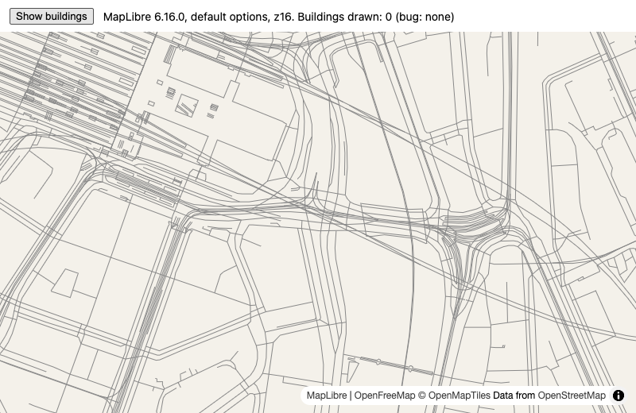
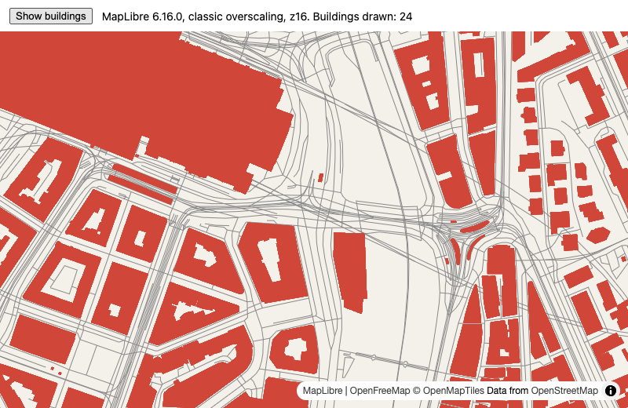

# MapLibre: a layer shown at runtime stays missing above the source's maxzoom

Nov 24, 2026 · research note · **Verdict: do not report.** It is already reported and fixed.

## Verdict

- The bug is MapLibre GL JS issue [#8918](https://github.com/maplibre/maplibre-gl-js/issues/8918), "Layer added with addLayer draws nothing beyond its source's maxzoom when no other layer uses its source-layer" (opened Oct 29, 2026, closed Nov 1, 2026).
- It was fixed by pull request [#8919](https://github.com/maplibre/maplibre-gl-js/pull/8919), released in **6.17.0** (Nov 7, 2026). The issue describes `addLayer`; our case (a hidden layer made visible) has the same cause and the same fix covers it: 6.17.0, 6.18.0 and 6.19.0 all pass our reproduction.
- Nothing to file and nothing to add to the issue: it is closed, the cause is described there, and the maintainers' fix already handles the visibility case.
- The app was on 6.16.0, the last affected release, with a workaround. We upgraded instead of reporting (see "What we did").

## Reproduction

[maplibre-overzoom-repro.html](maplibre-overzoom-repro.html): one page, the public MapLibre API and OpenFreeMap tiles only, none of our code. It is not published, because nothing is being filed; serve the folder locally (`python3 -m http.server` in `docs/upstream/`).

1. Load a style with a visible `road` layer (`transportation`) and a `building` fill with `visibility: none`, at z16 in Zurich. The source's `maxzoom` is 14.
2. Wait for `idle`.
3. `map.setLayoutProperty('building', 'visibility', 'visible')`.

Expected: buildings draw. Actual on 6.16.0: none draw, with no error. A second, visible layer on another source layer of the same source is needed; with the building layer alone, the bug does not show.

| 6.16.0, default options: 0 buildings | 6.16.0, `?classic`: 24 buildings | 6.19.0, default options: 44 buildings |
| --- | --- | --- |
|  |  |  |

Tested in headless Chrome 158 on macOS 27.2. The counts are `queryRenderedFeatures` on the building layer; they differ between modes because sliced and overscaled tiles cover the view differently.

## Versions

| Version | Result |
| --- | --- |
| 5.11.0 and earlier | Not affected: the slicing option does not exist |
| 5.12.0 to 5.24.1 | Affected only with `experimentalZoomLevelsToOverscale` set; not by default |
| 6.0.0 to 6.16.0 | **Affected by default** (`zoomLevelsToOverscale: 4`) |
| 6.17.0, 6.18.0, 6.19.0 (latest) | Fixed |

First affected version: **5.12.0** behind the experimental option, **6.0.0** by default. It came with the feature (slicing overzoomed tiles in the worker, [#6521](https://github.com/maplibre/maplibre-gl-js/pull/6521)), so it is a defect of the new code path and not a regression of older behaviour. Checked on 5.8.0, 5.9.0, 5.10.0, 5.11.0, 5.12.0, 5.24.1, 6.0.0, 6.16.0, 6.17.0, 6.18.0 and 6.19.0.

## Variants (6.16.0, at z15, z16 and z18; the same result at each zoom)

| Change that reveals the layer | Default options | Classic overscaling |
| --- | --- | --- |
| `setLayoutProperty(…, 'visibility', 'visible')` | **Missing** | Draws |
| `setStyle(style, { diff: true })` | **Missing** | Draws |
| `setStyle(style, { diff: false })` | **Missing** | Not tested |
| `addLayer` on a source layer not read before (the #8918 case) | **Missing** | Not tested |
| `setFilter` (layer visible from the start, filter matched nothing) | Draws | Not tested |
| `setLayerZoomRange` (layer visible from the start, `minzoom: 20`) | Draws | Not tested |

The pattern follows the cause. Above the source's `maxzoom` the worker cuts each tile out of the z14 tile and keeps only the source layers that a non-hidden layer reads at that moment. A layer with `visibility: none` does not count; a filtered or zoom-limited layer does. The worker then reuses that cut on reload and caches it by tile and URL, so leaving the area and returning, or replacing the whole style, gives the same incomplete tile.

## Our own usage

The app does nothing unsupported. It calls `map.setStyle(style, { diff: true })` with a style in which a layer's `layout.visibility` changes from `none` to `visible`. Replaying the app's two compiled styles (Single Ink, then Figure-Ground) in a plain MapLibre 6.16.0 page gives the same result as the app did: 0 buildings at z16 by default, 25 with classic overscaling, 50 on 6.19.0.

## What we did (Nov 24, 2026)

- Upgraded the app and the exported snippet's CDN pin from 6.16.0 to **6.19.0**, which has the upstream fix.
- Removed the workaround (`zoomLevelsToOverscale: undefined`) from [src/ui/MapView.tsx](../../src/ui/MapView.tsx). The app and the exports now both run on MapLibre's defaults, so they place labels the same way above z14.
- Kept `npm run check-reveal` as a regression test. It passes on 6.19.0 without the workaround.
